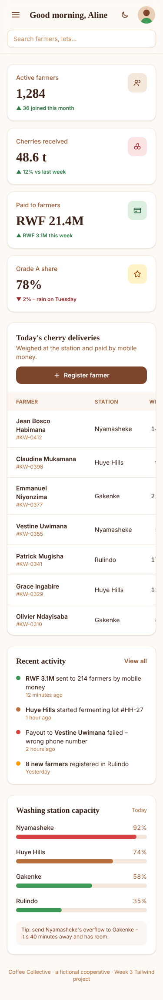
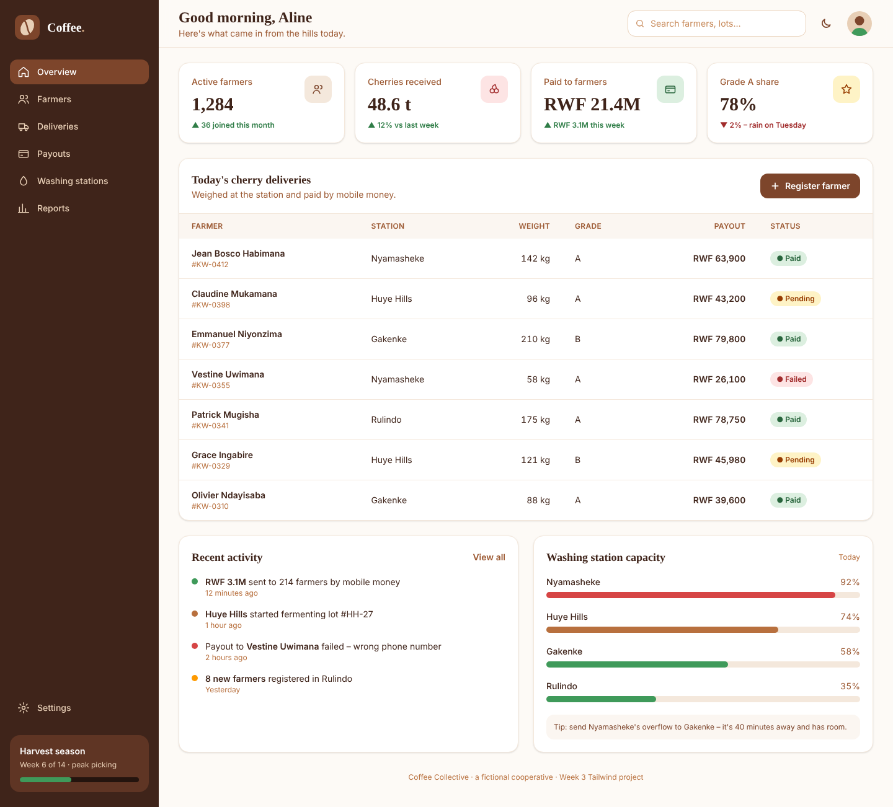

# Coffee Collective – Tailwind Admin Dashboard

🔗 **Live site:** https://YOUR-Tetaaline.github.io/week3-tailwind-dashboard/ 

A responsive admin dashboard for **Coffee Collective**, a fictional coffee farmers' cooperative. Staff use it to track farmers, coffee-cherry deliveries, mobile-money payouts and washing-station capacity.

Built with **Tailwind CSS v4** + **Vite**, plain HTML and a few lines of JavaScript.

## Screenshots

| Mobile (375px) | Desktop (1440px) |
| --- | --- |
|  |  |

## Features

- Sidebar with logo and 7 icon links. It slides in on mobile and is always visible from `lg:` up.
- Top bar with page title, search, dark-mode toggle and avatar.
- 4 stat cards: 1 column → 2 at `md:` → 4 at `xl:`.
- Deliveries table with 7 rows and Paid / Pending / Failed badges. It scrolls sideways on small screens.
- "Recent activity" and "Washing station capacity" panels.
- "Register a farmer" modal with labeled inputs, a select and buttons.
- **Bonus:** dark mode (`dark:` variant, remembered in localStorage) and a mobile menu toggle.

## Run it locally

```bash
npm install
npm run dev      # start dev server
npm run build    # production build in dist/
```

## Project structure

```
index.html            # all markup (Tailwind utility classes)
src/style.css         # the only CSS file: Tailwind entry, @theme, @layer components
src/main.js           # menu toggle, dark mode, modal
public/               # logo + avatar SVGs
vite.config.js        # Vite + @tailwindcss/vite plugin
.github/workflows/    # auto-deploy to GitHub Pages
```

## How I customized Tailwind

<!-- Rewrite this section in your own words before submitting. -->

All customization lives in `src/style.css`, my only CSS file. Inside `@theme` I added a coffee-inspired brand palette. `bean` is a full 50–950 scale of roasted browns used for the sidebar, text and buttons. `leaf` is a green for positive numbers and "Paid" badges, and `cherry` is a red for warnings and failures. I also added a warm `cream` page background. Because these are theme variables, Tailwind generates utilities like `bg-bean-700` and `text-leaf-600` automatically. I set two custom fonts: **Plus Jakarta Sans** as the default `font-sans` and **Fraunces**, a serif, as a new `font-display` for headings and big numbers. I also added a class-based `dark` variant so a button can switch themes.

In `@layer components` I used `@apply` to build reusable classes: `.card`, `.card-title`, `.btn`, `.btn-primary`, `.btn-ghost`, `.nav-link`, `.badge` (plus `.badge-paid`, `.badge-pending` and `.badge-failed`), `.form-label` and `.form-input`. Each one bundles a long class list, including hover, focus and dark styles, so the HTML stays short and every card, button and input looks the same.
